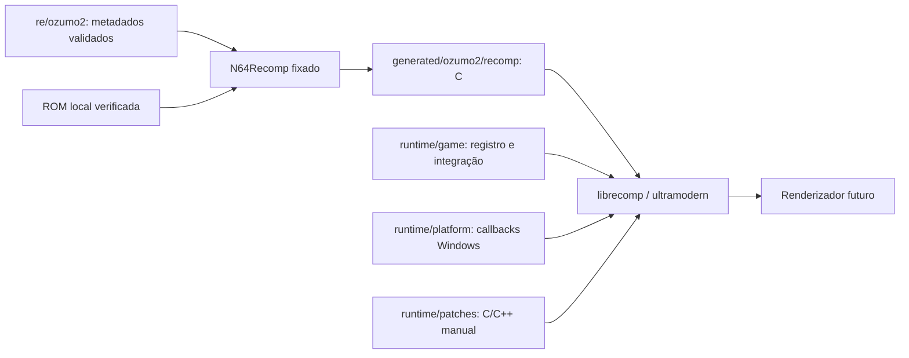

# Organização da fase nativa de 64 Ōzumō 2

Esta fase prepara o desenvolvimento Windows e a validação dinâmica. A análise comparativa continua como referência histórica: `reports/`, os documentos anteriores em `docs/`, `config/roms.json`, as configurações Splat, as ROMs e os resultados existentes não são movidos nem regenerados.

| Diretório | Responsabilidade e política |
| --- | --- |
| `reports/`, `docs/metodologia.md` | Evidência da comparação anterior, preservada |
| `config/splat/` | Configurações existentes de ambos os jogos, preservadas |
| `tools/*.py`, `tests/test_analysis.py` | Analisador anterior e sua suíte; agora incluídos no versionamento |
| `re/ozumo2/` | Plano de captura e metadados revisados do segundo jogo |
| `re/ozumo2/symbols/` | Futuras atribuições de símbolos, com referência e confiança |
| `re/ozumo2/recomp/` | Critérios para futuros símbolos/ELF/TOML de uma prova limitada |
| `runtime/game/` | Integração específica do jogo: identificação, entrada, saves, overlays e callbacks |
| `runtime/platform/` | Adaptadores Windows de janela, entrada, áudio, caminhos e relógio de apresentação |
| `runtime/patches/` | C/C++ escrito manualmente, legível e revisável, substituindo apenas funções aprovadas |
| `runtime/localization/`, `runtime/mods/` | Limites previstos para funcionalidades futuras; não implementadas nesta fase |
| `tools/development/` | Build reproduzível de ferramentas upstream e teste sintético |
| `config/toolchain.lock.json` | Revisões exatas de ferramentas e submódulos; sem fontes de terceiros vendorizadas |
| `generated/ozumo2/recomp/` | Futuro C gerado e metadados automáticos; ignorados pelo Git |
| `local/traces/ozumo2/` | Capturas privadas, entradas de controle e dumps de RAM; ignorados |
| `local/assets/ozumo2/` | Futuros recursos derivados da ROM, somente locais |
| `.tools/`, `build/`, `dist/` | Dependências obtidas, logs e produtos de compilação; ignorados |
| `export/` | Recuperação documental anterior; permanece preservada, sem atualizar o ZIP ou o manifesto |

Não há movimentação dos scripts anteriores para `re/`: isso quebraria caminhos já testados sem benefício. Os novos diretórios apontam para as evidências existentes. `make analyze` continua disponível, mas não deve ser usado como etapa automática desta fase.

## Limites da arquitetura C/C++

O alvo é Windows x64 com C++20 para integração e C17 para código gerado, conforme upstream. O código de jogo traduzido fica separado dos adaptadores e das substituições manuais. Não se edita diretamente C gerado para implementar correções permanentes.

N64ModernRuntime fornece bibliotecas, não uma aplicação Windows pronta. Os callbacks do projeto ainda precisam conectar entrada, áudio, apresentação, carregamento de ROM e saves. RT64 é o renderizador recomendado upstream; a escolha da revisão e a compatibilidade com os microcódigos realmente usados dependerão da captura dinâmica. SDL, interface gráfica e empacotamento não são dependências desta preparação.

## Ordem de implementação

1. Capturar e validar os overlays conforme [o plano](../../re/ozumo2/overlay-validation.md).
2. Selecionar uma unidade pequena de código validado; elaborar metadados, sem converter automaticamente todos os limites heurísticos em funções recompiláveis.
3. Criar a primeira integração CMake da aplicação e os adaptadores mínimos Windows; testar boot, entrada e saída de uma função/contexto conhecido.
4. Só depois ampliar cobertura até uma sessão original de jogo reproduzível. Fixar formatos de saves e testar reinicialização/transições antes de alterações visuais.
5. Introduzir localização e mods por interfaces explícitas, após a fidelidade básica. Avaliar 1080p e interpolação visual em uma etapa separada.

Não existe executável de jogo ou implementação alternativa de engine nesta entrega. Isso evita cristalizar um loader antes de conhecer o ciclo de vida dos overlays.

## Simulação e apresentação

A cadência original da simulação deve ser medida; não se presume que todo VI execute um tick de lógica. A apresentação futura poderá ter resolução e cadência próprias, consumindo estados anteriores/atuais e um fator de interpolação. Input, timers, combate, RNG e saves seguem o relógio original. Não se aumenta a frequência de ticks para obter 60 FPS visuais e não se pressupõe que interpolar somente a câmera seja suficiente. Interpolações e correções widescreen exigem validação visual e testes de velocidade da simulação.

## Versionamento

ROMs, RAM, saves, mídia comercial, C gerado e dependências não entram no Git. Metadados observados e documentação revisada podem entrar, após revisão do conteúdo. As cópias históricas `export/generated/*.csv/json` são documentos já preservados, não outputs de compilação.

Antes de um commit ou envio, stage apenas os caminhos pretendidos e execute `make check-publish`. O verificador lê os blobs do índice Git, inclusive arquivos já rastreados, e rejeita diretórios privados, extensões de binários/mídia e assinaturas conhecidas. Ele não determina a origem autoral de todo texto ou mídia: a revisão dos arquivos adicionados continua necessária. Não é instalado hook que modifique a configuração pessoal do Git.
